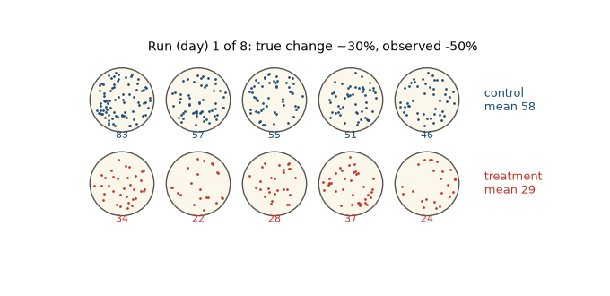
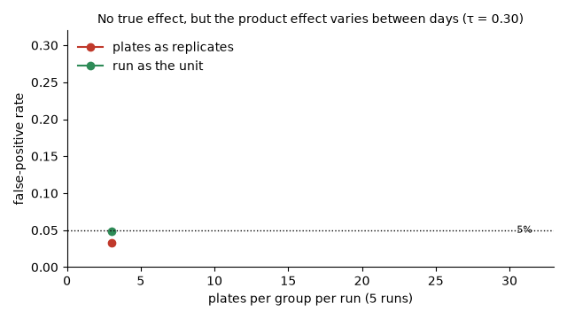
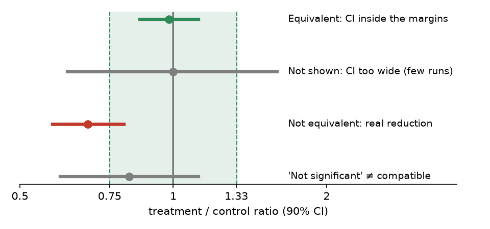
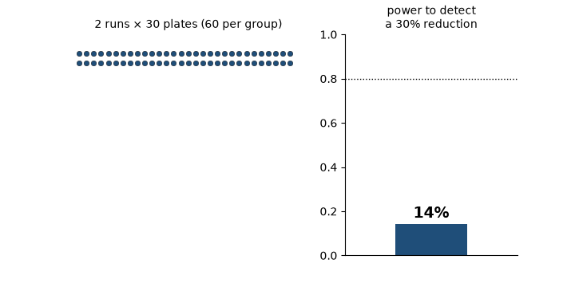
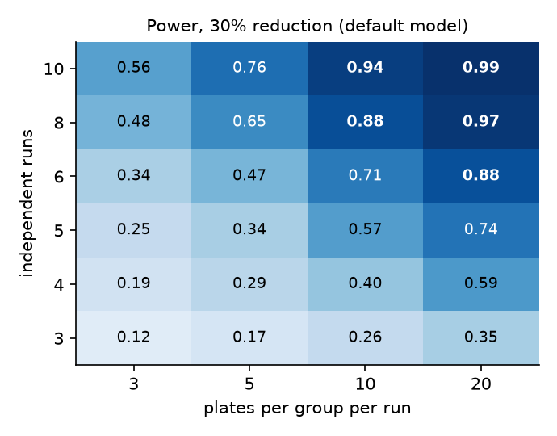

# compatpower

[](https://github.com/siriani/compatpower/actions/workflows/tests.yml)
[](https://doi.org/10.5281/zenodo.24380785)
[](https://pypi.org/project/compatpower/)
[](LICENSE)

**How many plates, and how many runs, does an in vitro compatibility assay need?**

`compatpower` simulates compatibility assays between biological control agents (for example entomopathogenic fungi such as *Beauveria* or *Metarhizium*, or *Trichoderma*) and pesticides. It tells you:

1. the **power** of your design to detect a given reduction in colony-forming units (CFU) or any count endpoint;
2. the probability of **demonstrating compatibility** with an equivalence test;
3. how to **split a fixed number of plates** into independent runs (days) and plates per run;
4. the **parameters of your own assay**, estimated from your plate counts.

```bash
pip install compatpower
compatpower allocate --total 60        # same 60 plates, split 2x30 ... 20x3
```

---

## Contents
- [Why this matters](#why-this-matters)
- [The assay as a statistical model](#the-assay-as-a-statistical-model)
- [What is the experimental unit?](#what-is-the-experimental-unit)
- [Compatibility is an equivalence claim](#compatibility-is-an-equivalence-claim)
- [Runs buy more than plates](#runs-buy-more-than-plates)
- [Usage](#usage) · [Estimating your own parameters](#estimating-your-own-parameters) · [Command line](#command-line)
- [Assumptions and limitations](#assumptions-and-limitations) · [Citation](#citation)

---

## Why this matters

A typical compatibility assay exposes the biological control agent to the product in culture medium, counts colonies (or measures germination, growth, sporulation) on **3–5 plates per treatment**, often in **a single run**, and declares the product *compatible* when the treatment **does not differ significantly** from the control.

That design has two statistical problems:

- **Low power.** With few plates and overdispersed counts, a harmful product is usually *not* significantly different from the control. "Not significant" is the expected outcome, not evidence of safety.
- **Pseudoreplication.** Plates prepared on the same day share medium, inoculum, dilution and incubation. They are sub-samples of one run, not independent replicates. Treating them as replicates makes the test answer the question "did this happen *on this day*?", not "does this product affect the agent?"

`compatpower` quantifies both problems for your own assay and gives a design that answers the question you actually care about.

## The assay as a statistical model

Each frame below is one simulated run (day) with five control and five treatment plates. The true effect is a 30% reduction, but the observed change jumps around from day to day:



Three sources of variation produce this:

| Source | Parameter | What it is |
|---|---|---|
| Plate to plate | `k` | Counts are overdispersed: negative binomial with variance $\mu + \mu^2/k$. Smaller `k` means noisier plates. |
| Day to day | `sd_run` | The whole run shifts up or down (medium, inoculum, incubation). It affects control and treatment alike. |
| Product × day | `tau` | The product effect itself varies between runs (dilution, contact time, state of the inoculum). |

Formally, for run $r$, group $g$ (0 = control, 1 = treatment) and plate $i$:

$$
y_{rgi} \sim \mathrm{NB}\left(\mu_{rg}, k\right), \qquad
\log \mu_{rg} = \log \mu_0 + a_r + g \cdot \big(\log(1-\delta) + c_r\big),
$$

$$
a_r \sim \mathcal N(0, \sigma_{\text{run}}^2), \qquad c_r \sim \mathcal N(0, \tau^2),
$$

where $\delta$ is the true proportional reduction (e.g. 0.3 for 30%).

**A consequence that surprises many people:** when control and treatment are run on the same day, the day effect $a_r$ **cancels** in the comparison. What limits the assay is the plate noise ($k$) and the interaction $\tau$, not the day-to-day drift of the control. The drift matters when treatments are compared with a control from another day (shared or historical controls).

## What is the experimental unit?

`compatpower` compares three analyses, all on $\log(y + 0.5)$:

| `analysis=` | Unit | Equivalent to |
|---|---|---|
| `"pooled"` | plate | one-way ANOVA / *t* test pooling all plates (common practice) |
| `"blocked"` | plate, run as block | mixed model with a random run intercept only |
| `"run"` | **run** | paired *t* test on per-run differences of log means; mixed model with run × treatment term |

When there is no true effect but the product effect varies between days, the plate-level analyses produce false positives, and **adding plates makes it worse**. Only the run-level analysis keeps the nominal 5%:



The reason is that more plates shrink the plate-level standard error towards zero, while the day-to-day variation of the effect ($\tau$) stays. The test becomes very confident about a difference that belongs to *that particular day*.

## Compatibility is an equivalence claim

"The product is compatible" means "the effect is too small to matter". That is not the same as "the effect was not significant". The right tool is an **equivalence test**: two one-sided tests (TOST) on the treatment/control ratio, with margins fixed in advance (for example 0.75–1.33, i.e. at most a 25% change either way).



Compatibility is shown only when the whole 90% confidence interval of the ratio lies inside the margins. With a single run this almost never happens, whatever the number of plates, because the interval must also cover day-to-day variation, which one run cannot estimate.

### A one-sided question: non-inferiority

Compatibility is really one-sided: *does the product harm the agent?* A **non-inferiority** test (H₀: ratio ≤ margin) answers it with more power than the two-sided TOST.

**Which margin?** The default is **0.70**, the IOBC/WPRS "harmless" limit for laboratory tests on beneficial organisms (< 30% reduction; Sterk et al. 1999). An alternative is **0.66**, the ratio at the "compatible" class limit of the biological index IB (Rossi-Zalaf et al. 2008) when growth, sporulation and germination all drop by the same ratio $r$ ($IB = 100r > 66$). Neither was defined for CFU, so choose and justify your margin *before* the assay.

```python
from compatpower import noninferiority
noninferiority(runs=6, plates=10, margin=0.70)                       # P(declare compatible | harmless product), ~0.84
noninferiority(runs=6, plates=10, margin=0.70, true_reduction=0.30)  # type I error at the margin, ~0.05
```

## Analysing your own assay

`analyze()` runs the run-level non-inferiority test on real plate counts (one product at a time):

```python
import pandas as pd
from compatpower import analyze
analyze(pd.read_csv("examples/example_counts.csv"), margin=0.70)
# {'runs': 4, 'ratio': 0.72, 'lower_limit': 0.55, 'p_difference': 0.06, 'decision': 'not shown compatible', ...}
```

The example shows the central point. The difference is **not significant** (p = 0.06), so the usual practice would call the product "compatible". But the lower 95% limit of the ratio (0.55) is below the margin (0.70), so compatibility is **not shown**.

## Runs buy more than plates

Same effort, 60 plates per group, split differently:



And the full design table (power to detect a 30% reduction with the run-level analysis, default model):



Rules of thumb with the default parameters (CFU of a *B. bassiana* isolate):
- plan **at least 6–8 independent runs** to detect a 30% reduction with ~80% power;
- demonstrating equivalence needs even more (about 8 runs × 20 plates or 10 × 10 for margins 0.75–1.33);
- for a fixed number of plates, **more runs with fewer plates** is almost always better;
- low-variance endpoints (e.g. germination, which is close to binomial) need fewer plates per run, but the same number of runs.

Run `design_table()` with **your** parameters before relying on these numbers.

## Usage

```python
from compatpower import AssayModel, power, equivalence, design_table, allocate, required_runs

m = AssayModel(mu0=25, k=4.3, sd_run=0.48, tau=0.15)        # default parameters

power(runs=6, plates=10, reduction=0.3, model=m)               # ~0.70
power(runs=5, plates=20, reduction=0.0, model=AssayModel(tau=0.3), analysis="pooled")  # false-positive rate
equivalence(runs=8, plates=20, margin=(0.75, 1/0.75), model=m) # P(show compatibility | no true effect)
required_runs(plates=10, reduction=0.3, target=0.8, model=m)   # smallest number of runs for 80% power
allocate(total_plates=60, reduction=0.3, model=m)              # all splits of 60 plates
design_table(runs=(3, 4, 5, 6, 8, 10), plates=(3, 5, 10, 20), model=m)
```

All functions take `n_sim` (number of simulated assays, default 2000; Monte Carlo SE ≈ 1 percentage point), `alpha` (default 0.05) and `seed`.

## Estimating your own parameters

Put your plate counts in a CSV with one row per plate:

| run | group | product | count |
|---|---|---|---|
| day1 | control | | 31 |
| day1 | treatment | A | 22 |
| … | … | … | … |

```python
import pandas as pd
from compatpower import estimate_model, design_table

model, report = estimate_model(pd.read_csv("my_counts.csv"))
print(report)                 # k, sd_run, mu0, tau (+ warnings)
design_table(model=model)
```

- `k` is fitted by maximum likelihood (negative binomial, one mean per run × group).
- `sd_run` is estimated by the method of moments from the control means of different runs (needs ≥ 2 runs, and is imprecise with fewer than ~5).
- `tau` can be estimated **only if the same product was tested in two or more runs**. Otherwise an assumed value is used and the report says so. Repeating at least one product on different days is the single most informative thing a lab can do to plan its assays.

An example file with simulated data is in [`examples/example_counts.csv`](examples/example_counts.csv).

## Command line

```bash
compatpower power --runs 6 --plates 10 --reduction 0.3 [--analysis run|pooled|blocked]
compatpower equivalence --runs 8 --plates 20 --margin 0.75,1.333
compatpower noninferiority --runs 6 --plates 10 --margin 0.70
compatpower analyze examples/example_counts.csv --margin 0.70
compatpower allocate --total 60
compatpower table --out design.csv
compatpower estimate examples/example_counts.csv
# model options for every command: --mu0 --k --sd-run --tau --n-sim --seed --alpha
```

## Assumptions and limitations

- Counts are negative binomial within a run; run and run × treatment effects are normal on the log scale.
- Plate-level tests use $\log(y+0.5)$; run-level tests use the log of each run mean without offset (the offset biased the ratio and inflated the non-inferiority error). For the final analysis of real data, a negative binomial mixed model (run as random effect, with a run × treatment term) is the natural choice.
- The default parameters come from one isolate, one endpoint (CFU) and three runs; `tau` is assumed. They are a starting point, not a universal answer.
- Equivalence margins are a scientific decision. Link them to what matters agronomically (for example the class limits of a compatibility index), and fix them before the assay.

## Citation

Siriani ALR, Leite SMM. *compatpower: power, equivalence and design of in vitro compatibility assays between biological control agents and pesticides* (version 0.1.0). Zenodo; 2026. https://doi.org/10.5281/zenodo.24380785

All versions: https://doi.org/10.5281/zenodo.24380784. Please also cite the accompanying article (in preparation).

## Reproducing the figures

```bash
pip install -e . matplotlib pillow
python docs/make_figures.py
```

## License
MIT. Authors: Allan Lincoln Rodrigues Siriani (UNESP) and Susi Meire Maximino Leite (Centro Paula Souza, Fatec Pompeia).
